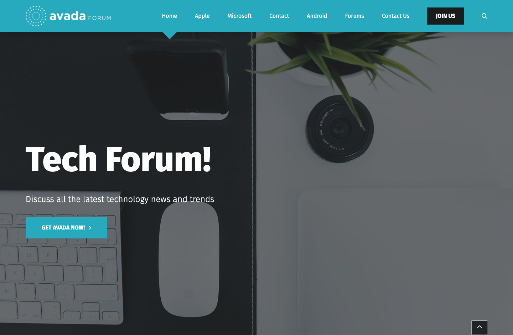

# Avada Forum

A recreation of a tech community homepage, built as an individual project during the Boolean programme in **December 2023**. The exercise focuses on Vue components, props and composing an editorial layout from an assigned reference.

**[Open the demo](https://massimoperuga.dev/en/demo/avada-forum)** · [Project in my portfolio](https://massimoperuga.dev/en/formazione/boolean#avada-forum) · [Italiano](README.md)

[](docs/images/avada-forum-full.png)

*Select the image to view the screenshot of the complete page.*

The [original assignment and exercise documentation](CONSEGNA.md), in Italian, is preserved in full.

## What it includes

- A header with logo and navigation, hero, news, forum categories, sign-up sections and a newsletter form.
- Editorial content presented as cards, featured articles and tutorial lists.
- Footer topics that expand on hover, and a back-to-top button.

## My work

I translated the assigned layout into Vue components, separating the header, main content and footer. I organised menus, news and topics into arrays of objects and built reusable components for buttons, headings and editorial formats. Avada provides the visual reference; my contribution is the frontend implementation.

## Stack and technical choices

| Area | Technologies |
| --- | --- |
| Interface | Vue 3, JavaScript, HTML |
| Styles and layout | Sass/SCSS, Bootstrap 5 |
| Development and build | Vite 5 |
| Typography and icons | Fira Sans, Font Awesome |

- **Data and props:** parent components define content and pass it to children; `v-for` generates menus and lists without repeating their template structure.
- **Editorial formats:** each news item’s type determines which component to display, keeping cards, articles and lists separate.
- **Shared and local styles:** SCSS variables and partials collect common styles; `scoped` styles stay with their components.

Code entry points: [App.vue](src/App.vue), [menu](src/components/Header/Menu.vue), [news](src/components/Main/News/News.vue) and [footer](src/components/Footer/Topics.vue).

## Running locally

You need **Node.js 22 and npm**, used for verification. Vite 5 also declares support for `^18.0.0 || >=20.0.0`. The application requires no database, credentials or external services.

```sh
git clone https://github.com/MassimoPeruga/proj-html-vuejs.git
cd proj-html-vuejs
npm ci
npm run dev
```

Open the address shown by Vite, usually [http://localhost:5173](http://localhost:5173). To generate and view the build, stop the development server and run:

```sh
npm run build
npm run preview
```

The preview is usually available at [http://localhost:4173](http://localhost:4173). Installation, startup, build and preview were checked with Node.js 22.22.0 and npm 10.9.4; Chrome checks covered image loading, menus, categories and footer interactions.

## Original project and portfolio demo

This repository preserves the original desktop layout. It is a visual recreation: discussions, accounts and newsletter subscriptions are not connected to a backend.

The portfolio demo adds mobile and tablet layout adjustments, internal navigation and demo feedback for the newsletter form. These changes live in the [portfolio adaptations](https://github.com/MassimoPeruga/portfolio/tree/production/site/demos), separately from this repository’s sources. The interface retains its original English content.
