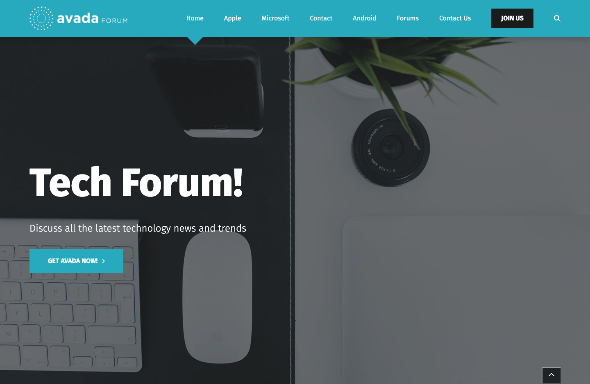

# Avada Forum

Riproduzione della homepage di una community tech, realizzata come progetto individuale del percorso Boolean nel **dicembre 2023**. L’esercizio mette in pratica componenti Vue, props e composizione di un layout editoriale a partire da un riferimento assegnato.

**[Apri la demo](https://massimoperuga.dev/demo/avada-forum)** · [Il progetto nel portfolio](https://massimoperuga.dev/formazione/boolean#avada-forum) · [English](README.en.md)

[](docs/images/avada-forum-full.png)

*Seleziona l’immagine per vedere lo screenshot della pagina completa.*

La [consegna e documentazione originale dell’esercizio](CONSEGNA.md) è conservata integralmente.

## Cosa include

- Header con logo e menu, hero, notizie, categorie del forum, inviti all’iscrizione e newsletter.
- Contenuti editoriali presentati come card, articoli in evidenza e liste di tutorial.
- Footer con argomenti espandibili al passaggio del mouse e pulsante per tornare in cima.

## Il mio lavoro

Ho tradotto il layout assegnato in componenti Vue, separando header, contenuto principale e footer. Ho organizzato menu, notizie e argomenti in array di oggetti e costruito componenti riutilizzabili per pulsanti, titoli e formati editoriali. Il riferimento grafico è Avada; il mio contributo è l’implementazione frontend.

## Stack e scelte tecniche

| Ambito | Tecnologie |
| --- | --- |
| Interfaccia | Vue 3, JavaScript, HTML |
| Stili e layout | Sass/SCSS, Bootstrap 5 |
| Sviluppo e build | Vite 5 |
| Tipografia e icone | Fira Sans, Font Awesome |

- **Dati e props:** i componenti padre definiscono i contenuti e li passano ai figli; `v-for` genera menu e liste evitando di ripetere la struttura nel template.
- **Formati editoriali:** il tipo di notizia determina il componente da mostrare, mantenendo distinti card, articoli e liste.
- **Stili condivisi e locali:** variabili e partial SCSS raccolgono gli stili comuni; gli stili `scoped` rimangono vicini ai componenti.

Punti d’ingresso: [App.vue](src/App.vue), [menu](src/components/Header/Menu.vue), [notizie](src/components/Main/News/News.vue) e [footer](src/components/Footer/Topics.vue).

## Avvio locale

Servono **Node.js 22 e npm**, usati nel collaudo. Vite 5 dichiara compatibilità anche con `^18.0.0 || >=20.0.0`. L’applicazione non richiede database, credenziali o servizi esterni.

```sh
git clone https://github.com/MassimoPeruga/proj-html-vuejs.git
cd proj-html-vuejs
npm ci
npm run dev
```

Apri l’indirizzo indicato da Vite, normalmente [http://localhost:5173](http://localhost:5173). Per generare e visualizzare la build, arresta il server di sviluppo e usa:

```sh
npm run build
npm run preview
```

L’anteprima è normalmente disponibile su [http://localhost:4173](http://localhost:4173). Installazione, avvio, build e anteprima sono stati verificati con Node.js 22.22.0 e npm 10.9.4; in Chrome sono stati controllati caricamento delle immagini, menu, categorie e interazioni del footer.

## Progetto originale e demo del portfolio

La repository conserva il layout desktop originale. Si tratta di una riproduzione visiva: discussioni, account e iscrizioni alla newsletter non sono collegati a un backend.

La demo nel portfolio aggiunge adattamenti per mobile e tablet, navigazione interna e un riscontro dimostrativo per il modulo newsletter. Questi interventi risiedono negli [adattamenti del portfolio](https://github.com/MassimoPeruga/portfolio/tree/production/site/demos), separati dai sorgenti di questa repository. L’interfaccia mantiene i contenuti originali in inglese.
